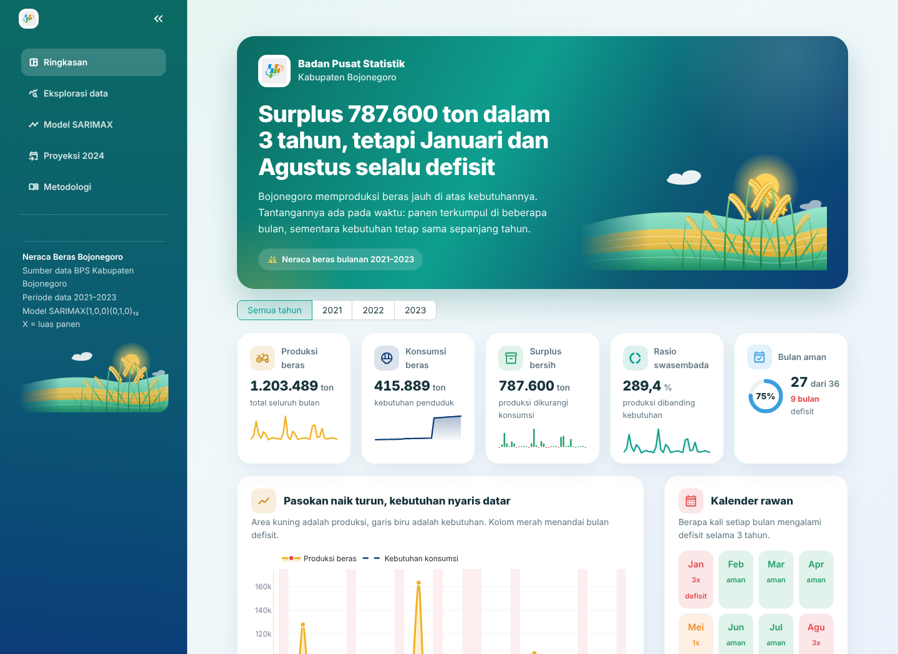
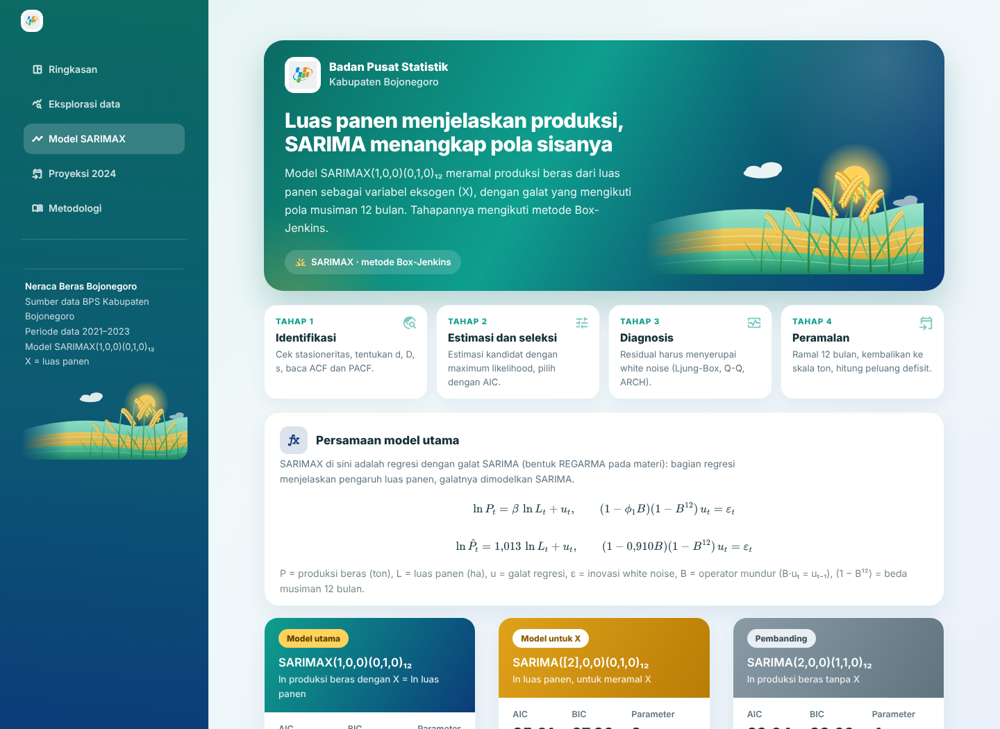
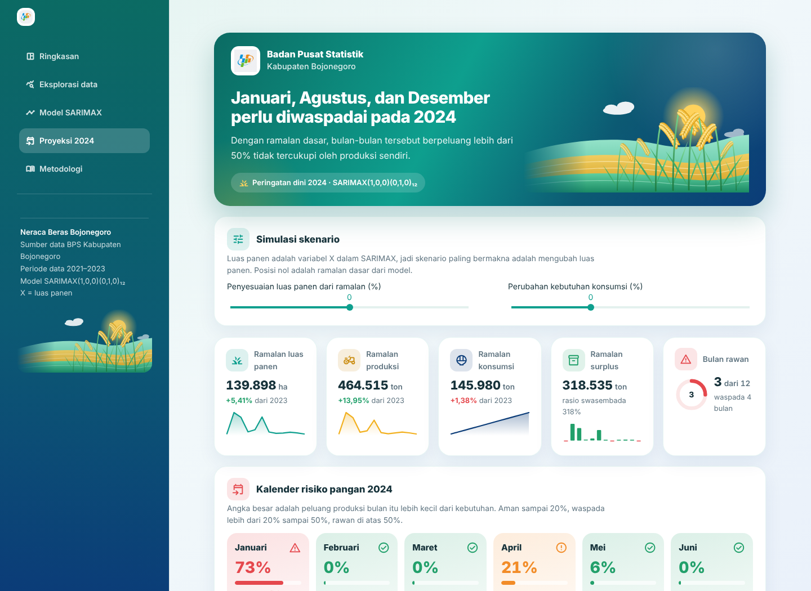

# Dashboard Neraca Beras Kabupaten Bojonegoro

Dashboard pemantauan dan peramalan neraca produksi dan konsumsi beras bulanan Kabupaten Bojonegoro, disusun dari data
**BPS Kabupaten Bojonegoro tahun 2021–2023**. Modelnya adalah **SARIMAX** dengan metode **Box-Jenkins**, dan
**luas panen** dipakai sebagai variabel eksogen (X).

**Dashboard:** https://GANTI-DENGAN-LINK-STREAMLIT.streamlit.app



---

## Model

SARIMAX di sini adalah **regresi dengan galat SARIMA** (bentuk REGARMA/ARMAX pada materi Analisis Deret Waktu Bab 5):

```
ln P_t = β · ln L_t + u_t
(1 − φ₁B)(1 − B¹²) u_t = ε_t
```

| Simbol | Arti |
|---|---|
| P_t | produksi beras bulan ke-t (ton) |
| L_t | luas panen bulan ke-t (ha), variabel eksogen X |
| u_t | galat regresi, bagian produksi yang tidak dijelaskan luas panen (produktivitas) |
| B | operator mundur, B·u_t = u_(t−1) |
| (1 − B¹²) | beda musiman 12 bulan |
| ε_t | inovasi white noise |

Karena luas panen tahun depan belum diketahui, luas panen juga diramal dengan model SARIMA sendiri (ramalan *ex ante*):

```
(1 − φ₂B²)(1 − B¹²) ln L_t = ε_t        →  SARIMA([2],0,0)(0,1,0)₁₂
```

| Model | Fungsi | Hasil estimasi |
|---|---|---|
| **SARIMAX(1,0,0)(0,1,0)₁₂**, X = ln luas panen | model utama produksi | β = 1,013 (p < 0,001), φ₁ = 0,910 (p < 0,001), AIC −86,83 |
| SARIMA([2],0,0)(0,1,0)₁₂ | meramal luas panen (X) | φ₂ = −0,482 (p = 0,042), AIC 35,01 |
| SARIMA(2,0,0)(1,1,0)₁₂ | pembanding tanpa X | AIC 33,94 |
| ARIMA(0,1,0) dengan drift | meramal konsumsi | drift sekitar 20,8 ton per bulan |

**Cara membaca:** β ≈ 1 berarti luas panen naik 1% membuat produksi naik sekitar 1,01%. Ini wajar, karena produksi beras
adalah luas panen dikali produktivitas. φ₁ = 0,91 berarti perubahan produktivitas dibanding bulan yang sama tahun lalu
cenderung berlanjut ke bulan berikutnya, karena BPS menetapkan produktivitas per subround empat bulan.

---

## Tahapan Box-Jenkins

1. **Identifikasi.** Data ditransformasi ln agar varians stabil. Uji ADF dan KPSS, lalu ACF dan PACF. ACF ln produksi
   di lag 12 sebesar 0,59, jauh di atas batas ±0,33, sehingga ditetapkan **s = 12, D = 1, d = 0**.
2. **Estimasi dan seleksi.** Semua kombinasi p, q ∈ {0,1,2} dan P, Q ∈ {0,1} diestimasi dengan *maximum likelihood*.
   Dipilih AIC terkecil di antara kandidat yang **seluruh parameternya signifikan (5%)** dan **residualnya lolos Ljung-Box**.
   Daftar kandidat dihitung ulang otomatis setiap kali data berubah.
3. **Diagnosis.** Diuji ACF residual, Ljung-Box lag 6 dan 12, Q-Q plot, Shapiro-Wilk, Jarque-Bera, dan ACF residual
   kuadrat atau ARCH-LM. Dua belas residual pertama dibuang (d + Ds = 12).
4. **Peramalan.** Luas panen 2024 diramal, lalu dimasukkan ke SARIMAX. Hasilnya dikembalikan ke ton dengan eksponen.
   Peluang defisit dihitung dari sebaran normal ramalan ln produksi, dengan varians yang menggabungkan galat SARIMAX
   dan ketidakpastian ramalan luas panen (β² × varians ramalan ln L).

### Hasil diagnosis model utama

| Uji | p-value | Keputusan |
|---|---|---|
| Ljung-Box lag 6 | 0,487 | tidak ada autokorelasi |
| Ljung-Box lag 12 | 0,434 | tidak ada autokorelasi |
| ARCH-LM lag 4 | 0,531 | tidak ada efek ARCH |
| Shapiro-Wilk | 0,008 | residual belum normal |
| Jarque-Bera | 0,024 | residual belum normal |

Residual tidak berautokorelasi dan tidak menunjukkan efek ARCH, jadi model layak dipakai untuk meramal. Normalitas belum
terpenuhi karena beberapa residual besar di awal subround, ketika angka produktivitas BPS berganti. Karena itu rentang
95% dan peluang defisit dibaca sebagai perkiraan.

### Uji ramalan 2023

Model dilatih ulang dengan data 2021–2022, lalu dipakai meramal 2023:

| Metode | MAE (ton) | RMSE (ton) | MAPE |
|---|---|---|---|
| SARIMAX *ex post* (luas panen aktual) | 2.298 | 3.291 | 7,2% |
| SARIMAX *ex ante* (luas panen diramal) | 17.385 | 27.647 | 49,5% |
| Naif musiman (sama dengan tahun lalu) | 16.620 | 25.704 | 47,7% |
| SARIMA tanpa X | 20.802 | 34.732 | 62,0% |

Bila luas panen bulan itu sudah diketahui, kesalahan SARIMAX hanya sekitar 7%. Bila luas panen juga harus diramal,
kesalahannya setara dengan naif musiman, karena waktu panen 2023 tampak bergeser dari dua tahun sebelumnya. Jadi
ramalan sebaiknya diperbarui setiap kali angka luas panen terbaru (misalnya hasil KSA) tersedia.

---

## Halaman dashboard

| Halaman | Isi |
|---|---|
| **Ringkasan** | kartu indikator, produksi dan kebutuhan per bulan, kalender rawan, siklus musim, daftar bulan defisit |
| **Eksplorasi data** | statistik deskriptif, pola musiman, antar tahun, alasan transformasi ln, luas panen dan produktivitas per subround, nilai ekstrem |
| **Model SARIMAX** | alur Box-Jenkins dalam 6 tab: identifikasi, seleksi model, estimasi, diagnosis, uji ramalan 2023, dan contoh menghitung ramalan dengan tangan |
| **Proyeksi 2024** | simulasi skenario luas panen dan konsumsi, kalender risiko, ramalan produksi dan luas panen dengan rentang 95%, peta surplus dan defisit 2021–2024, tabel serta unduhan CSV |
| **Metodologi** | tahapan analisis, sumber data, kategori risiko, rujukan, keterbatasan |



### Ramalan 2024 (ramalan dasar)

| | Nilai |
|---|---|
| Ramalan luas panen | 139.898 ha (+5,4% dari 2023) |
| Ramalan produksi | 464.515 ton (+14,0% dari 2023) |
| Ramalan konsumsi | 145.980 ton |
| Bulan rawan (peluang defisit > 50%) | Januari (73%), Agustus (69%), Desember (78%) |
| Bulan waspada (20–50%) | April, Juli, September, November |

Kategori: **Aman** jika peluang defisit sampai 20%, **Waspada** jika lebih dari 20% sampai 50%, dan **Rawan** jika di atas 50%.
Ambang ini ditetapkan peneliti sebagai patokan pemantauan, bukan ketentuan baku.



---

## Keterbatasan

- **Data pendek.** Hanya ada 3 siklus musim. Setelah beda musiman tersisa 24 pengamatan, sehingga rentang ramalan lebar.
- **Residual belum normal**, jadi rentang 95% dan peluang defisit adalah perkiraan.
- **Ramalan bergantung pada luas panen.** Pergeseran waktu panen tidak bisa diketahui dari data lampau.
- **Produktivitas dianggap berlanjut.** Komponen AR(1) membawa kenaikan produktivitas akhir 2023 ke 2024, sehingga
  ramalan produksi 2024 lebih tinggi dari 2023. Angka ini perlu dicek dengan data resmi BPS 2024.
- **Konsumsi** diramal dengan ARIMA(0,1,0) ber-drift dan dianggap pasti dalam perhitungan peluang defisit.

---

## Struktur folder

```
neraca-beras-dashboard/
├── app.py                     ← dashboard Streamlit
├── analisis_sarimax.py        ← seluruh perhitungan model (identifikasi, seleksi, diagnosis, ramalan)
├── requirements.txt
├── .streamlit/config.toml     ← tema warna
├── assets/logo_bps.png
├── data/
│   ├── Data_Neraca_Beras_Bojonegoro_2021_2023.csv   ← data mentah
│   └── data_neraca_beras_bersih.csv                 ← data yang dibaca dashboard
├── hasil/                     ← tabel hasil SARIMAX (kandidat, koefisien, diagnosis, evaluasi, proyeksi)
│   └── arsip_regresi/         ← hasil model regresi versi sebelumnya
├── notebooks/
│   ├── analisis_sarimax.ipynb ← proses lengkap langkah demi langkah (bisa dibuka di Colab)
│   └── arsip_regresi/         ← notebook regresi versi sebelumnya
└── docs/                      ← tangkapan layar untuk README
```

## Menjalankan di komputer sendiri

```powershell
python -m venv venv
venv\Scripts\activate            # macOS/Linux: source venv/bin/activate
pip install -r requirements.txt
streamlit run app.py
```

Saat pertama kali dibuka, dashboard menghitung semua kandidat model (sekitar 10–20 detik), lalu hasilnya disimpan di cache.
Untuk melihat ringkasan model tanpa membuka dashboard, jalankan `python analisis_sarimax.py`.

## Sumber dan rujukan

- Data: Badan Pusat Statistik Kabupaten Bojonegoro, neraca produksi dan konsumsi beras bulanan 2021–2023.
- Huang, C. & Petukhina, A. (2022). *Applied Time Series Analysis and Forecasting with Python*. Springer.
- Mishra, P. dkk. (2025). Climate modeling for South Asia: Statistical and deep learning for rainfall and temperature
  prediction. *Scientific Reports, 15*, 38235.
- Hošovský, A. dkk. (2021). Comparative study of week-ahead forecasting of daily gas consumption in buildings using
  regression ARMA/SARMA and genetic-algorithm-optimized regression wavelet neural network models.
  *Journal of Building Engineering, 34*, 101955.

---

Disusun oleh **Irma Liza** dalam kegiatan magang di BPS Kabupaten Bojonegoro.
